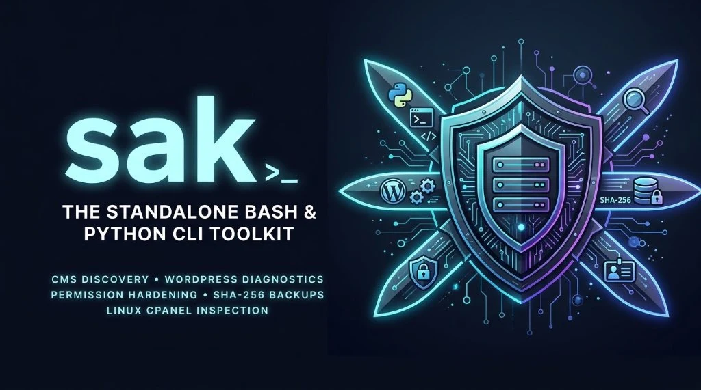

# sak — Swiss Army Knife: Kit de Operaciones CMS y cPanel (`v2.0.0`)



Una CLI moderna e independiente en Bash + Python 3 para **detección de CMS, diagnóstico WordPress, auditoría/corrección de permisos, backups `chmod 600` con SHA-256 y listado de usuarios Linux/cPanel** — reemplazando el legado `sak` (`0.1.5`, 2013) con subcomandos limpios y salidas `table` / `json` / `csv`.

## Modernización Histórica

Inspirado en el **Swiss Army Knife (`sak` v0.1.5, `20130930.A`)** original desarrollado por **Jon South (`jsouth@hostgator.com`, HostGator.com)**.

En `v2.0.0`, el script original de 2.153 líneas fue reescrito en **Bash + Python 3.6+ (stdlib)** eliminando dependencias obsoletas (`LWP GET`, `dialog`/curses, URLs muertas de HostGator), el límite de `8` caracteres por usuario y añadiendo backups `chmod 600` con SHA-256 y validación contra path traversal.

## Ejemplo de Salida Real

```text
$ ./sak.sh scan -p /tmp/sak-e2e/site --no-color
=== sak.sh v2.0.0 | scan ===
APPLICATION  VERSION  PATH
---------------------------------------------
WordPress    6.6.1    /tmp/sak-e2e/site
```

## Licencia

Apache-2.0 — ver [LICENSE](LICENSE).
