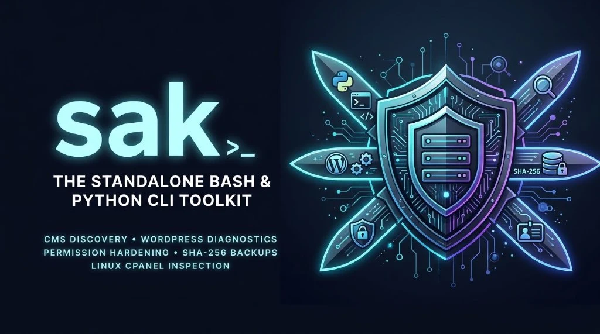

# sak — Swiss Army Knife: Kit de Operações CMS e cPanel (`v2.0.0`)



Uma CLI moderna e independente em Bash + Python 3 para **detecção de CMS, diagnóstico WordPress, auditoria/correção de permissões, backups `chmod 600` com SHA-256 e listagem de usuários Linux/cPanel** — substituindo o legado `sak` (`0.1.5`, 2013) com subcomandos limpos e saídas `table` / `json` / `csv`.

## Modernização Histórica

Inspirado no **Swiss Army Knife (`sak` v0.1.5, `20130930.A`)** original criado por **Jon South (`jsouth@hostgator.com`, HostGator.com)**.

Na versão `v2.0.0`, o script legado de 2.153 linhas foi reescrito em **Bash + Python 3.6+ (stdlib)** para eliminar dependências mortas e limitações antigas:
- **Remoção de Dependências Mortas**: Elimina downloads remotos de `vdetect`, `LWP GET`, menus `dialog`/curses e URLs antigas da HostGator.
- **Fim dos Limites Legados**: Remove a restrição de `UID >= 500` e `username <= 8 caracteres` na leitura de contas Linux/cPanel.
- **Endurecimento de Segurança**: Adiciona backups `chmod 600` com manifesto SHA-256, extração protegida contra path traversal (`restore`) e checagem MySQL via `--defaults-extra-file` (`chmod 600`).

## Exemplo de Saída Real

```text
$ ./sak.sh scan -p /tmp/sak-e2e/site --no-color
=== sak.sh v2.0.0 | scan ===
APPLICATION  VERSION  PATH
---------------------------------------------
WordPress    6.6.1    /tmp/sak-e2e/site
```

## Licença

Apache-2.0 — veja [LICENSE](LICENSE).
